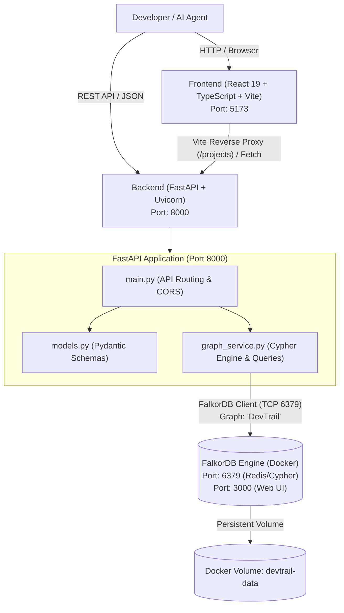
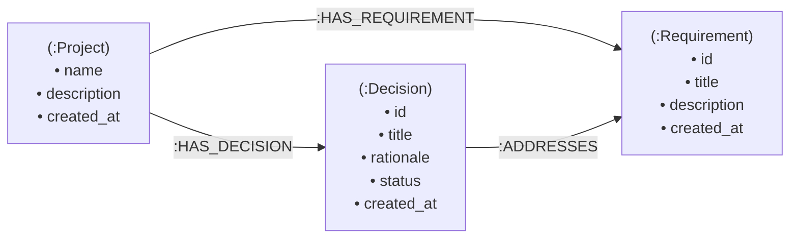

# DevTrail

> **Graph-Based Engineering Memory Workspace**  
> Built for **Graph Hacks: Context for AI Agents**

[](https://fastapi.tiangolo.com)
[](https://www.falkordb.com/)
[](https://react.dev/)
[](https://www.typescriptlang.org/)
[](https://vitejs.dev/)

---

## Table of Contents

- [A. Project Title & Overview](#a-project-title--overview)
- [B. Problem Statement](#b-problem-statement)
- [C. Proposed Solution](#c-proposed-solution)
- [D. Existing Features](#d-existing-features)
- [E. Technology Stack](#e-technology-stack)
- [F. Architecture](#f-architecture)
- [G. Graph Data Model & Relationships](#g-graph-data-model--relationships)
- [H. Actual API Endpoints](#h-actual-api-endpoints)
- [I. Important Cypher Queries](#i-important-cypher-queries)
- [J. Prerequisites](#j-prerequisites)
- [K. Exact Installation & Setup Instructions](#k-exact-installation--setup-instructions)
- [L. Docker & FalkorDB Startup Instructions](#l-docker--falkordb-startup-instructions)
- [M. Backend Startup Instructions](#m-backend-startup-instructions)
- [N. Frontend Startup Instructions](#n-frontend-startup-instructions)
- [O. Example Workflow](#o-example-workflow)
- [P. Testing & Production-Build Instructions](#p-testing--production-build-instructions)
- [Q. Current Limitations](#q-current-limitations)
- [R. Future Improvements](#r-future-improvements)
- [S. Hackathon Context](#s-hackathon-context)

---

## A. Project Title & Overview

**DevTrail** is a graph-based engineering memory workspace designed to maintain continuous architectural context for developers and autonomous AI agents. Powered by **FalkorDB** and **FastAPI**, with a responsive **React 19 + TypeScript + Vite** developer interface, DevTrail models engineering projects, system requirements, and Architecture Decision Records (ADRs) as an interconnected knowledge graph.

Instead of losing technical justifications across ephemeral chats, pull request comments, and disparate markdown notes, DevTrail structures engineering rationale into traversable graph relationships. AI coding agents and human engineers can record, connect, and inspect architectural decisions in real time with graph-native consistency.

---

## B. Problem Statement

Autonomous AI agents and engineering teams frequently suffer from **context amnesia and decision drift**:

1. **Context Window Limitations**: Large Language Models (LLMs) have bounded context windows and no persistent native memory across developer sessions. Settled architectural trade-offs are repeatedly re-debated or silently forgotten.
2. **Context Fragmentation**: System requirements live in issue trackers, design choices are scattered across chat channels and PR threads, and code lives in repositories. No single source connects *why* a technical choice was made to *which requirement* prompted it.
3. **Flat Document Weakness**: Flat files and standard relational tables struggle with multi-hop context queries (e.g., *"Which architecture decisions address Requirement X?"*, *"What requirements are affected if Decision Y is deprecated?"*, or *"Which requirements have no addressing decisions?"*).
4. **Agent Hallucination & Violation**: Without structured grounding in past decisions, AI agents propose implementations that violate previously agreed architectural constraints (such as storage engines, auth flows, or data isolation rules).

---

## C. Proposed Solution

DevTrail replaces disjointed documentation with a **low-latency, persistent knowledge graph** backed by FalkorDB:

- **Entity Modeling**: Projects, Requirements, and Technical Decisions are stored as discrete, typed graph nodes with unique identifiers and timestamps.
- **Explicit Graph Links**: First-class graph edges (`HAS_REQUIREMENT`, `HAS_DECISION`, `ADDRESSES`) form an auditable, traversable decision trail.
- **Idempotency with Cypher MERGE**: Graph operations leverage Cypher `MERGE` clauses, preventing duplicate nodes and relationships while preserving original creation metadata.
- **Agent Grounding Workspace**: Exposes REST endpoints that AI agents and IDE tools can invoke to inspect previous architectural decisions before writing code, and an intuitive developer UI for human review and exploration.

---

## D. Existing Features

The current DevTrail implementation provides a working, production-built MVP with the following verified capabilities:

- [x] **Project Management**:
  - Create and select engineering projects idempotently via `POST /projects` and `GET /projects`.
  - Project switcher in the sidebar with live graph reload and project metadata inspection.
  - Project overview dashboard displaying node counts and graph relationship totals.
- [x] **Requirements Directory**:
  - Record project-scoped requirements with custom IDs (e.g., `REQ-GRAPH-PERSIST`) or auto-slugified identifiers.
  - Real-time search by requirement ID, title, or keyword.
  - Connected decision count badges showing which ADRs satisfy each requirement.
- [x] **Architecture Decision Records (ADRs)**:
  - Document architectural decisions with titles, detailed justification/rationale, and lifecycle status (`accepted`, `proposed`, `deprecated`).
  - Optional immediate requirement linking during decision creation.
  - Status filtering (`all`, `accepted`, `proposed`, `deprecated`) and full-text keyword search across titles and rationale.
- [x] **Graph Relationship Linking**:
  - Link decisions to requirements via `[:ADDRESSES]` relationships.
  - Dedicated endpoint `POST /projects/{project_name}/decisions/{decision_id}/requirements/{requirement_id}` for establishing graph edges.
  - Live modal to link additional unlinked requirements to an existing decision.
- [x] **Decision Details & Graph Inspector**:
  - Modal view displaying architectural rationale, creation timestamp, and all connected requirements.
  - Interactive selection to link requirements directly from the modal.
- [x] **Memory Lookup (Graph Memory Explorer)**:
  - Unified explorer querying the active project's graph memory.
  - Visual Cypher graph trace path rendering: `(:Project)-[:HAS_DECISION]->(:Decision)-[:ADDRESSES]->(:Requirement)`.
  - Type filters (`All`, `Decisions`, `Requirements`) and quick tag shortcuts (`#sqlite`, `#offline`, `#cypher`, `#accepted`, `#storage`).
  - Raw JSON inspection accordion for reviewing node payloads returned by the API.
- [x] **Live Database Connection Indicator**:
  - Real-time connection badge in the sidebar monitoring FalkorDB host and port (`:6379`).
  - Global error banners with retry triggers upon network or database interruption.

> [!NOTE]
> DevTrail currently performs deterministic graph traversal and structured property lookups. Natural-language AI question answering and direct OpenAI/Claude integrations are planned future improvements and are not present in the current MVP codebase.

---

## E. Technology Stack

### Backend
- **Python 3.12+**
- **FastAPI (0.143+)**: Modern, high-performance async REST framework.
- **FalkorDB Python Client (1.8.0)**: Official Python SDK for communicating with FalkorDB over Redis protocol.
- **Pydantic v2 (2.14+)**: Request parsing, validation, and serialization with custom validators.
- **Uvicorn (0.54+)**: High-performance ASGI server.

### Database
- **FalkorDB (v1.8+ / latest)**: Redis-compatible in-memory graph database with a low-latency Cypher query engine running in Docker.

### Frontend
- **React 19 (`react` 19.2.8, `react-dom` 19.2.8)**
- **TypeScript (~6.0.2)**
- **Vite 8 (`vite` ^8.3.0)**: Next-generation bundler with `@vitejs/plugin-react`.
- **Lucide React (1.59+)**: Iconography.
- **Oxlint (1.81+)**: High-performance JavaScript/TypeScript linter.
- **Custom Dark-Theme Design System**: Clean, zero-dependency CSS variables developer UI.

---

## F. Architecture

### System Architecture Diagram



### Request Flow
1. **Frontend / API Client** issues requests to FastAPI (`http://127.0.0.1:8000`).
2. **Pydantic Models** (`models.py`) validate request bodies, stripping whitespace and enforcing length/type constraints.
3. **Graph Service** (`graph_service.py`) formats parameterized openCypher queries and dispatches them via the `falkordb` client.
4. **FalkorDB** executes the Cypher query against the `DevTrail` graph, persisting changes to disk via the Docker volume mount.
5. The result set is transformed into typed Pydantic responses and returned as JSON.

---

## G. Graph Data Model & Relationships

DevTrail models knowledge using three core node labels and three directed relationships:



### Node Specifications

#### 1. `(:Project)`
Represents an engineering software project or service boundary.
- `name` *(string, unique)*: Project identifier (e.g., `"DevTrail"`, `"AuthService"`).
- `description` *(string, optional)*: Overview of project scope.
- `created_at` *(string, ISO 8601 UTC)*: Timestamp when first created.

#### 2. `(:Requirement)`
Represents a functional or non-functional engineering requirement.
- `id` *(string, unique)*: Requirement identifier (e.g., `"REQ-GRAPH-PERSIST"` or auto-generated `"req-offline-support"`).
- `title` *(string)*: Requirement title.
- `description` *(string, optional)*: Technical specification details.
- `created_at` *(string, ISO 8601 UTC)*: Timestamp when recorded.

#### 3. `(:Decision)`
Represents an Architecture Decision Record (ADR) detailing an architectural choice.
- `id` *(string, unique)*: Decision identifier (e.g., `"DEC-FASTAPI-REACT"` or auto-generated `"dec-use-sqlite"`).
- `title` *(string)*: Architectural decision summary.
- `rationale` *(string)*: Detailed technical justification, trade-offs, and alternative analysis.
- `status` *(string)*: Lifecycle status (`"accepted"`, `"proposed"`, `"deprecated"`).
- `created_at` *(string, ISO 8601 UTC)*: Timestamp when recorded.

### Relationship Specifications

| Relationship | Source Node | Target Node | Properties | Description |
|---|---|---|---|---|
| `HAS_REQUIREMENT` | `(:Project)` | `(:Requirement)` | None | Scopes a requirement node to a specific project. |
| `HAS_DECISION` | `(:Project)` | `(:Decision)` | None | Scopes an architecture decision node to a specific project. |
| `ADDRESSES` | `(:Decision)` | `(:Requirement)` | `created_at` *(ISO timestamp)* | Connects a decision to the requirement it fulfills. |

---

## H. Actual API Endpoints

The backend is built with FastAPI and runs by default at `http://127.0.0.1:8000`.

### Health & Diagnostics

| Method | Endpoint | Description | Request Body | Response Model |
|---|---|---|---|---|
| `GET` | `/` | Backend health check | None | `{"message": "DevTrail backend is running!"}` |
| `GET` | `/test-db` | Verify FalkorDB connectivity | None | `{"database_result": ...}` |

### Project Endpoints

| Method | Endpoint | Description | Request Body | Response Model |
|---|---|---|---|---|
| `POST` | `/projects` | Create or select a project (idempotent `MERGE`) | `ProjectCreate` | `ProjectResponse` |
| `GET` | `/projects` | List all projects | None | `List[ProjectResponse]` |
| `GET` | `/projects/{project_name}` | Retrieve a project by name | None | `ProjectResponse` |

### Requirement Endpoints

| Method | Endpoint | Description | Request Body | Response Model |
|---|---|---|---|---|
| `POST` | `/projects/{project_name}/requirements` | Create requirement and link to project | `RequirementCreate` | `RequirementResponse` |
| `GET` | `/projects/{project_name}/requirements` | List all requirements for a project | None | `List[RequirementResponse]` |
| `GET` | `/projects/{project_name}/requirements/{requirement_id}` | Retrieve requirement by ID | None | `RequirementResponse` |

### Decision Endpoints

| Method | Endpoint | Description | Request Body | Response Model |
|---|---|---|---|---|
| `POST` | `/projects/{project_name}/decisions` | Record decision and optionally connect requirement | `DecisionCreate` | `DecisionWithRequirementsResponse` |
| `POST` | `/projects/{project_name}/decisions/{decision_id}/requirements/{requirement_id}` | Link an existing decision to a requirement | None | `DecisionWithRequirementsResponse` |
| `GET` | `/projects/{project_name}/decisions` | List all decisions with connected requirements | None | `List[DecisionWithRequirementsResponse]` |
| `GET` | `/projects/{project_name}/decisions/{decision_id}` | Retrieve decision with connected requirements | None | `DecisionWithRequirementsResponse` |

### Payload Schemas

#### `ProjectCreate`
```json
{
  "name": "DevTrail",
  "description": "Graph-based engineering memory workspace"
}
```

#### `RequirementCreate`
```json
{
  "id": "REQ-GRAPH-PERSIST",
  "title": "Persistent Graph-Memory System",
  "description": "Store ADRs and requirements in a graph database to retain AI agent context."
}
```

#### `DecisionCreate`
```json
{
  "id": "DEC-FASTAPI-REACT",
  "title": "Decoupled FastAPI Backend and React+Vite Frontend",
  "rationale": "Enables standalone agent REST access alongside an interactive developer workspace.",
  "status": "accepted",
  "requirement_id": "REQ-GRAPH-PERSIST"
}
```

#### `DecisionWithRequirementsResponse`
```json
{
  "id": "DEC-FASTAPI-REACT",
  "title": "Decoupled FastAPI Backend and React+Vite Frontend",
  "rationale": "Enables standalone agent REST access alongside an interactive developer workspace.",
  "status": "accepted",
  "created_at": "2026-10-17T13:50:00Z",
  "requirements": [
    {
      "id": "REQ-GRAPH-PERSIST",
      "title": "Persistent Graph-Memory System",
      "description": "Store ADRs and requirements in a graph database to retain AI agent context.",
      "created_at": "2026-10-17T13:48:00Z"
    }
  ]
}
```

---

## I. Important Cypher Queries

The following parameterized Cypher queries are executed by `graph_service.py`:

### 1. Create or Select Project Idempotently
```cypher
MERGE (p:Project {name: $name})
ON CREATE SET 
    p.description = $description,
    p.created_at = $created_at
ON MATCH SET 
    p.description = CASE WHEN $description IS NOT NULL AND $description <> '' THEN $description ELSE p.description END,
    p.created_at = CASE WHEN p.created_at IS NULL THEN $created_at ELSE p.created_at END
RETURN p.name AS name, p.description AS description, p.created_at AS created_at
```

### 2. Create Requirement and Attach to Project
```cypher
MATCH (p:Project {name: $project_name})
MERGE (r:Requirement {id: $req_id})
ON CREATE SET 
    r.title = $title,
    r.description = $description,
    r.created_at = $created_at
ON MATCH SET 
    r.title = $title,
    r.description = CASE WHEN $description IS NOT NULL AND $description <> '' THEN $description ELSE r.description END
MERGE (p)-[:HAS_REQUIREMENT]->(r)
RETURN r.id AS id, r.title AS title, r.description AS description, r.created_at AS created_at
```

### 3. Create Decision and Attach to Project
```cypher
MATCH (p:Project {name: $project_name})
MERGE (d:Decision {id: $dec_id})
ON CREATE SET 
    d.title = $title,
    d.rationale = $rationale,
    d.status = $status,
    d.created_at = $created_at
ON MATCH SET 
    d.title = $title,
    d.rationale = $rationale,
    d.status = $status
MERGE (p)-[:HAS_DECISION]->(d)
RETURN d.id
```

### 4. Connect Decision to Requirement (`:ADDRESSES`)
```cypher
MATCH (p:Project {name: $project_name})
MATCH (p)-[:HAS_DECISION]->(d:Decision {id: $dec_id})
MATCH (p)-[:HAS_REQUIREMENT]->(r:Requirement {id: $req_id})
MERGE (d)-[rel:ADDRESSES]->(r)
ON CREATE SET rel.created_at = $created_at
RETURN d.id
```

### 5. Retrieve Decision with Connected Requirements
```cypher
MATCH (p:Project {name: $project_name})-[:HAS_DECISION]->(d:Decision {id: $dec_id})
OPTIONAL MATCH (d)-[:ADDRESSES]->(r:Requirement)
RETURN d.id AS id,
       d.title AS title,
       d.rationale AS rationale,
       d.status AS status,
       d.created_at AS created_at,
       collect(r) AS requirements
LIMIT 1
```

### 6. List All Decisions with Connected Requirements
```cypher
MATCH (p:Project {name: $project_name})-[:HAS_DECISION]->(d:Decision)
OPTIONAL MATCH (d)-[:ADDRESSES]->(r:Requirement)
RETURN d.id AS id,
       d.title AS title,
       d.rationale AS rationale,
       d.status AS status,
       d.created_at AS created_at,
       collect(r) AS requirements
ORDER BY d.created_at ASC
```

---

## J. Prerequisites

Ensure the following tools are installed on your host system:

- **Docker Engine / Docker Desktop** (v20.10+): Required to run the FalkorDB container.
- **Python 3.10+** (Tested on Python 3.12): Required for the backend API.
- **Node.js 18+ & npm 9+** (Tested on Node.js 20+): Required for the React/Vite frontend.
- **Git**: For repository version control.

---

## K. Exact Installation & Setup Instructions

### 1. Clone Repository
```bash
git clone https://github.com/Mufeed06-cmd/devtrail.git
cd devtrail
```

### 2. Verify Repository Layout
```
devtrail/
├── .gitignore
├── graph_service.py       # FalkorDB Cypher database operations
├── main.py                # FastAPI endpoints & application setup
├── models.py              # Pydantic schemas and validators
├── frontend/              # React 19 + TypeScript + Vite workspace
│   ├── package.json
│   ├── vite.config.ts
│   ├── src/
│   └── ...
└── README.md
```

---

## L. Docker & FalkorDB Startup Instructions

DevTrail requires a running FalkorDB instance on port `6379`.

### 1. Launch FalkorDB via Docker
```bash
docker run -d \
  --name devtrail-falkordb \
  -p 6379:6379 \
  -p 3000:3000 \
  -v devtrail-data:/var/lib/falkordb/data \
  --restart unless-stopped \
  falkordb/falkordb:latest
```

### 2. Verify FalkorDB Health
```bash
docker exec -it devtrail-falkordb redis-cli PING
```
*Expected Output:*
```
PONG
```

> [!TIP]
> The FalkorDB container also exposes the **FalkorDB Web Browser** at `http://localhost:3000` for visual graph schema inspection and custom Cypher queries.

### 3. Stopping and Restarting FalkorDB
```bash
# Stop the container
docker stop devtrail-falkordb

# Restart the container (persisted data is retained)
docker start devtrail-falkordb
```

---

## M. Backend Startup Instructions

### 1. Create and Activate Virtual Environment
From the project root (`~/devtrail`):

```bash
python3 -m venv .venv
source .venv/bin/activate
```

### 2. Install Python Dependencies
```bash
pip install fastapi uvicorn falkordb pydantic
```

### 3. Run FastAPI Server
```bash
uvicorn main:app --reload --host 127.0.0.1 --port 8000
```

### 4. Verify Backend Health
In another terminal:
```bash
curl http://127.0.0.1:8000/
```
*Expected Output:*
```json
{"message":"DevTrail backend is running!"}
```

- **Interactive Swagger UI**: Open [http://127.0.0.1:8000/docs](http://127.0.0.1:8000/docs) in your browser.
- **ReDoc Documentation**: Open [http://127.0.0.1:8000/redoc](http://127.0.0.1:8000/redoc).

---

## N. Frontend Startup Instructions

### 1. Install Node Dependencies
From the `frontend` directory:

```bash
cd frontend
npm install
```

### 2. Run Vite Development Server
```bash
npm run dev
```

*Expected Output:*
```
  VITE v8.3.4  ready in 180 ms

  ➜  Local:   http://localhost:5173/
  ➜  Network: use --host to expose
```

### 3. Open the Workspace
Open [http://localhost:5173](http://localhost:5173) in your browser.

> [!NOTE]
> `frontend/vite.config.ts` automatically proxies `/projects` requests to `http://127.0.0.1:8000`. If running on a custom host or port, configure `VITE_API_BASE_URL` in `frontend/.env`.

---

## O. Example Workflow

Follow this end-to-end workflow to populate and query the graph memory:

### Step 1: Create or Select a Project
1. In the sidebar, click **Select Project...** or the **+ Create or Select Project** button.
2. Enter Name: `DevTrail` and Description: `Engineering memory workspace`.
3. Click **Create or Select**. The project node is registered in FalkorDB via Cypher `MERGE`.

### Step 2: Record a System Requirement
1. Navigate to the **Requirements** tab.
2. Click **+ New Requirement**.
3. Fill in:
   - **ID**: `REQ-GRAPH-PERSIST` (or leave empty for auto-slug)
   - **Title**: `Persistent Graph-Memory System`
   - **Description**: `Persist architectural decisions and requirements in FalkorDB to prevent AI agent context drift.`
4. Click **Save Requirement**. FalkorDB creates `(:Project)-[:HAS_REQUIREMENT]->(:Requirement)`.

### Step 3: Record an Architecture Decision Record (ADR)
1. Navigate to the **Decisions** tab.
2. Click **+ Record Decision**.
3. Fill in:
   - **ID**: `DEC-FASTAPI-REACT`
   - **Title**: `Decoupled FastAPI Backend and React+Vite Frontend`
   - **Status**: `Accepted`
   - **Connect to Requirement**: Select `REQ-GRAPH-PERSIST`
   - **Rationale**: `A decoupled architecture allows AI agents to query the REST API directly while giving developers an interactive web interface.`
4. Click **Record Decision**. FalkorDB creates:
   - `(:Project)-[:HAS_DECISION]->(:Decision)`
   - `(:Decision)-[:ADDRESSES]->(:Requirement)`

### Step 4: Inspect Decision Relationships
1. Click on the decision card to open the **Decision Details Modal**.
2. Notice the connected requirement badge `REQ-GRAPH-PERSIST: Persistent Graph-Memory System`.
3. To link an additional requirement, select one from the **Connect Another Requirement** dropdown and click **Link in Graph**.

### Step 5: Query in Memory Lookup
1. Navigate to the **Memory Lookup** tab.
2. Type `FastAPI` or `REQ-GRAPH-PERSIST` into the search bar.
3. Observe the visual graph trace:
   ```
   (:Project "DevTrail") -[:HAS_DECISION]-> (:Decision "DEC-FASTAPI-REACT") -[:ADDRESSES]-> (:Requirement "REQ-GRAPH-PERSIST")
   ```
4. Click **Inspect JSON Payload** to view the raw node structure returned by the graph traversal.

---

## P. Testing & Production-Build Instructions

### Frontend Build Verification
Verify that the TypeScript types compile and Vite successfully creates a production bundle:

```bash
cd frontend
npm run build
```
*Expected Output:*
```
> tsc -b && vite build
✓ built in ~450ms
dist/index.html                   0.48 kB
dist/assets/index-*.css          12.54 kB
dist/assets/index-*.js          279.59 kB
```

### Frontend Code Quality Check
Run Oxlint on the TypeScript codebase:
```bash
cd frontend
npm run lint
```

### Preview Production Build
```bash
cd frontend
npm run preview
```

### Backend Direct Verification
To verify FalkorDB querying directly from Python:
```bash
python -c "from falkordb import FalkorDB; db = FalkorDB(host='localhost', port=6379); graph = db.select_graph('DevTrail'); print('Node count:', graph.query('MATCH (n) RETURN count(n)').result_set)"
```

---

## Q. Current Limitations

- **Structured Search vs. Natural Language**: Memory Lookup currently relies on structured keyword and property matching across nodes and edges. Natural language semantic query answering via LLM embedding search is not yet integrated.
- **Single Graph Namespace**: All projects in an instance share the `DevTrail` graph namespace in FalkorDB, partitioned by `(:Project)` nodes and relationship boundaries.
- **No Native Authentication**: The current MVP is designed for local development and paired agent usage; it does not currently enforce multi-tenant authentication or API token verification.
- **Node Mutation Lifecycle**: The MVP supports adding projects, requirements, decisions, and relationships. Node deletion and cascade pruning endpoints are not yet exposed in the REST API.
- **One-Way Traversal Direction**: Decision-to-requirement links are stored directed as `(Decision)-[:ADDRESSES]->(Requirement)`.

---

## R. Future Improvements

- [ ] **Model Context Protocol (MCP) Server**: Expose DevTrail endpoints as an official MCP server, allowing Claude Desktop, Cursor, and Antigravity agents to automatically query and record decisions during coding sessions.
- [ ] **Hybrid GraphRAG Engine**: Vectorize requirement descriptions and decision rationale using embedding models, enabling hybrid Cypher + semantic vector retrieval for natural-language agent questions.
- [ ] **Automated Architecture Conflict Detection**: Prompt an agent when a proposed decision contradicts previously accepted ADRs or obsoletes an active requirement.
- [ ] **Interactive 2D/3D Graph Canvas**: Embed a visual force-directed graph canvas (e.g., Cytoscape.js or Force Graph) directly into the DevTrail web interface.
- [ ] **CI/CD Pull Request Linter**: GitHub Action that verifies incoming code changes against recorded architectural decisions in DevTrail.

---

## S. Hackathon Context

- **Event**: [Graph Hacks: Context for AI Agents](https://graphhacks.devpost.com/)
- **Theme**: Leveraging Graph Databases to Provide Grounding, Context, and Memory for Autonomous AI Systems.
- **Core Insight**: Standard LLM context windows fail when engineering projects scale across weeks and multiple contributors. By structuring software requirements and architectural decisions into a **FalkorDB graph**, DevTrail transforms tribal developer knowledge into a deterministic, queryable memory store for both humans and AI agents.

---

*DevTrail — Making engineering decisions permanent, connected, and queryable.*
